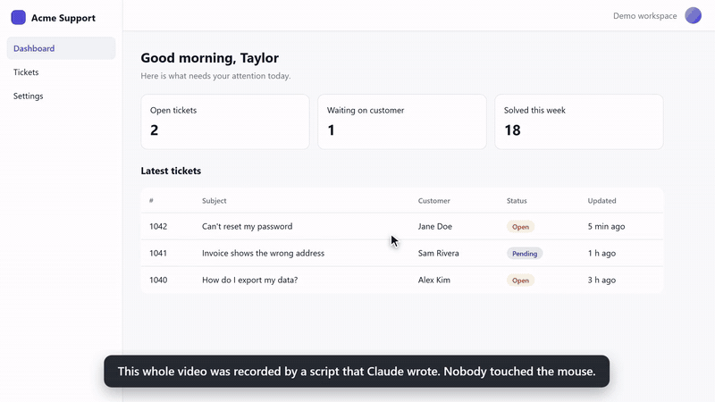

# claude-skills

Skills for [Claude Code](https://claude.com/claude-code), packaged as a plugin marketplace you can install in two commands.

## 🎬 video-guide: polished product walkthroughs, recorded by Claude



▶️ **[Watch the full narrated demo (1:50)](examples/acme-demo/output/video-guide-demo.mp4)** · 📄 **[See the guide it built](examples/acme-demo/output/acme-guide_EN.html)** · 🧪 [Source of the demo](examples/acme-demo/)

Ask Claude *"make a video guide of our app"*. It writes a Playwright scenario, records the app, and gives you back **two deliverables from the same run**:

1. **A walkthrough video** that looks edited, not just captured:
   - a **camera that zooms and pans** to each step and eases back out, like Screen Studio's auto-zoom;
   - a cursor that glides along a curved path, really hovers the element (the app's own hover styles show) and squishes when it clicks;
   - a soft highlight ring with a step number, and a spotlight that dims the rest of the screen;
   - captions that fade and slide in, are never cropped by the zoom, and move to the top when they would cover the button they describe;
   - animated chapter title cards, with **cross-fades** instead of hard cuts;
   - optional **AI voice-over** ([ElevenLabs](https://elevenlabs.io)) that sounds like one continuous take: each line is generated with its neighbours as context, no step ends before its sentence has, the track is normalised to −16 LUFS, and a very quiet room tone fills the gaps between lines.
2. **An illustrated step-by-step guide.** It is a single HTML file with every screenshot embedded and the click target circled and numbered, ready to email. It can come in several languages from one recording.

Because both come from one script, **the video and the screenshots always show the same thing**. When the app changes, you re-record with one command instead of re-shooting by hand.

### What makes it practical for real projects

- **Privacy on shared test servers.** Rows and menu items that don't belong to your demo data are blurred, and counters can be hidden. You tell it which elements are rows and counters in your app with a few CSS selectors (the `privacy` option; the built-in defaults fit one particular app).
- **No passwords during recording.** Test accounts sign in once and the session is reused. This also avoids sign-in rate limits.
- **The voice is cached per sentence**, so re-recording after a UI change costs no new characters, and a silent rehearsal mode costs none at all.
- **No hidden notes in client deliverables.** The guide builder refuses to write HTML comments.
- **Traps already solved** are written into the skill: embedded widgets blocked by origin checks, AI answers with variable timing, buttons with no accessible name, ffmpeg 8 flag changes, and more.

### Install

In Claude Code:

```
/plugin marketplace add Ibrahim-dvp/claude-skills
/plugin install video-guide@ibrahim-skills
```

Or from a terminal:

```sh
claude plugin marketplace add Ibrahim-dvp/claude-skills
claude plugin install video-guide@ibrahim-skills
```

Update later with `/plugin marketplace update ibrahim-skills`.

### Requirements

- Node.js 18+, then `npm i playwright` and `npx playwright install chromium` in your working folder
- `ffmpeg` and `ffprobe` on your PATH, **version 7.1 or newer** (made on 9.0; older builds use a fallback that has not been run)
- Optional, for the voice-over: an ElevenLabs API key in `~/.elevenlabs-key` or `ELEVENLABS_API_KEY`. For anything you publish or give to a client, use a plan whose licence allows commercial use.

### One command

```sh
node make.js --scenario record.js --guide guide.json --voice <voice id> --out out/name
```

| Step | What happens |
|---|---|
| dry pass | The scenario runs fast, without video, to collect the spoken lines and the stills. |
| voice | One clip per line, cached. `--voice stub` makes silent clips, to rehearse for free. |
| record | The scenario runs for real, at 2x resolution; every step waits for its line. |
| assemble | Zoom and pan, cross-fades, captions, voice, loudness. Writes `<out>.mp4`. |
| guide | Writes `<out>-guide_EN.html` (one file per language). |

Every step is cached on its inputs, so a second run only redoes what changed. Options:
`--no-zoom` (static camera), `--no-spotlight` (no dimming), `--size 1920x1080` (must keep the
recording's 16:9 shape; another shape is refused, not stretched), `--fps 50`, `--xfade 0.5`
(`0` = hard cuts), `--no-room` or `--room-db -60` (the room tone under the voice), `--music bed.mp3`
(your own licensed file, kept very quiet and ducked under the voice; no music is shipped), `--force`.

### How it works

| Script | Role |
|---|---|
| `make.js` | Runs the whole pipeline, with a cache. |
| `recorder-kit.js` | `show(page, locator, caption, { click })` sends the camera and the cursor to the element, hovers it, rings it, captions it, takes a still and clicks. Also `titleCard`, `say`, `typeSlow`, `scroll`, `cut` (hide a page load behind a cross-fade), chapters and segments. |
| `overlay.js` | Injected into each page. Draws the cursor, ring, spotlight, badge, ripple and title cards, and blurs data that isn't part of the demo (selectors set with the kit's `privacy` option). |
| `voice.js` | ElevenLabs text-to-speech with request stitching: `--list-voices`, `--voice <id>`, `--stub`. |
| `assemble.js`, `camera.js` | The edit, with ffmpeg: the zoom is applied after recording from the target rectangles the kit logged, as one eased curve; captions are composited on top afterwards. |
| `build-guide.js` | The HTML guide in any number of languages, built from `guide.json`. |
| `example/` | A two-chapter scenario, a session-saving login script, and a guide config. |

Full instructions, the recording checklist and the known traps are in [`SKILL.md`](plugins/video-guide/skills/video-guide/SKILL.md).

## Contributing

Issues and pull requests are welcome. To add a skill:

1. Create `plugins/<name>/.claude-plugin/plugin.json` and `plugins/<name>/skills/<name>/SKILL.md`.
2. Register it in `.claude-plugin/marketplace.json`.
3. Bump `version` in `plugin.json` on every change, so installed copies get the update.

## License

[MIT](LICENSE) © Ibrahim Bensaadoune
